# Wallpaper gallery

Sixteen original wallpapers, four for each Modus variant. Every image is a native 1672 × 941 PNG, created with OpenAI’s built-in imagegen tool. Click a preview or title for the full image. Complete prompts and provenance are linked by theme.

## Modus Vivendi

[Theme bundle](../themes/modus-vivendi/README.md) · [Complete prompts and sources](../themes/modus-vivendi/SOURCES.md)

| Index | Wallpaper | Preview |
| --- | --- | --- |
| 0 | [Moonlit grove](../themes/modus-vivendi/wallpapers/01-moonlit-grove.png) | <a href="../themes/modus-vivendi/wallpapers/01-moonlit-grove.png">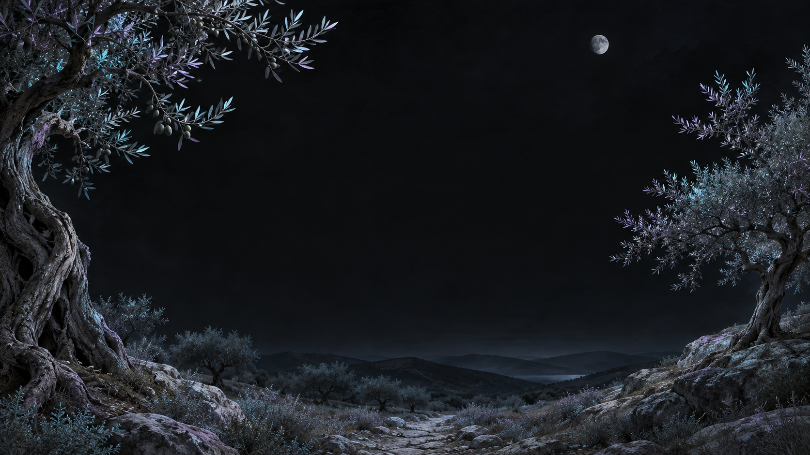</a> |
| 1 | [Celestial reason](../themes/modus-vivendi/wallpapers/02-celestial-reason.png) | <a href="../themes/modus-vivendi/wallpapers/02-celestial-reason.png">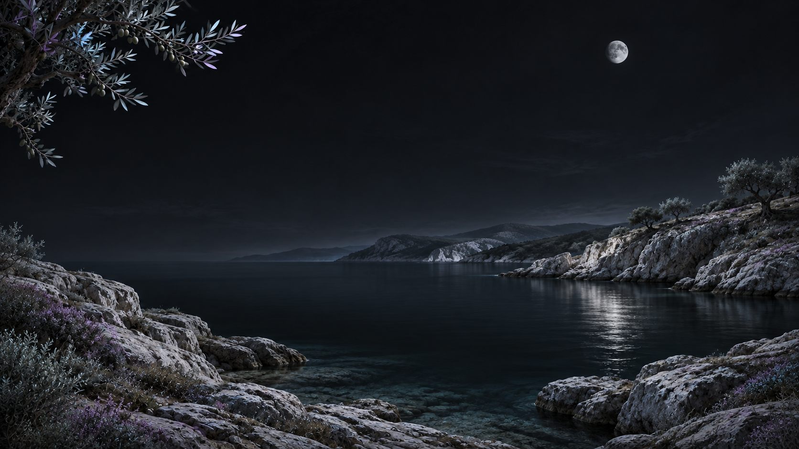</a> |
| 2 | [Ink archipelago](../themes/modus-vivendi/wallpapers/03-ink-archipelago.png) | <a href="../themes/modus-vivendi/wallpapers/03-ink-archipelago.png">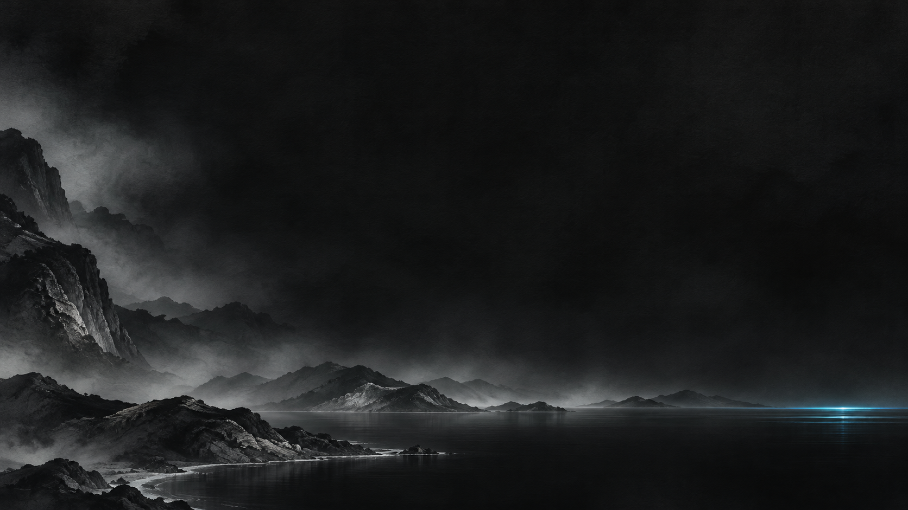</a> |
| 3 | [The unwritten study](../themes/modus-vivendi/wallpapers/04-unwritten-study.png) | <a href="../themes/modus-vivendi/wallpapers/04-unwritten-study.png">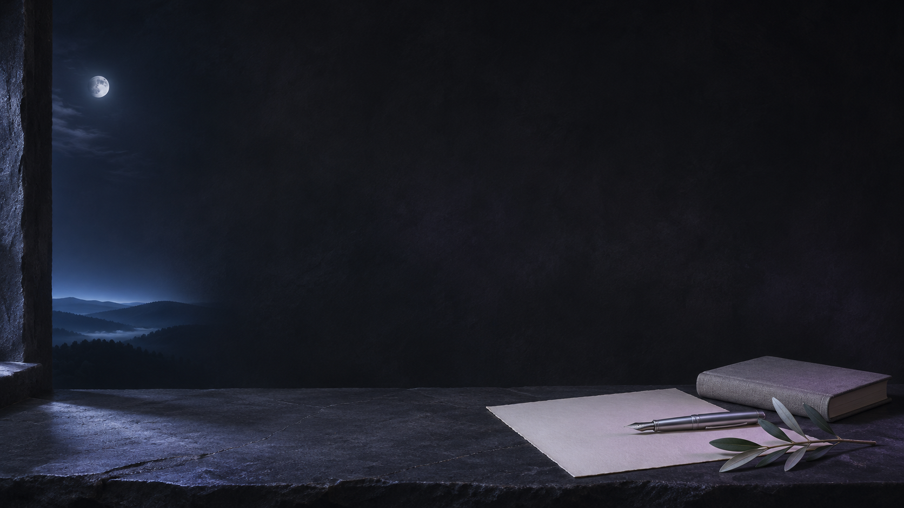</a> |

## Modus Operandi

[Theme bundle](../themes/modus-operandi/README.md) · [Complete prompts and sources](../themes/modus-operandi/SOURCES.md)

| Index | Wallpaper | Preview |
| --- | --- | --- |
| 0 | [Courtyard of clarity](../themes/modus-operandi/wallpapers/01-courtyard.png) | <a href="../themes/modus-operandi/wallpapers/01-courtyard.png">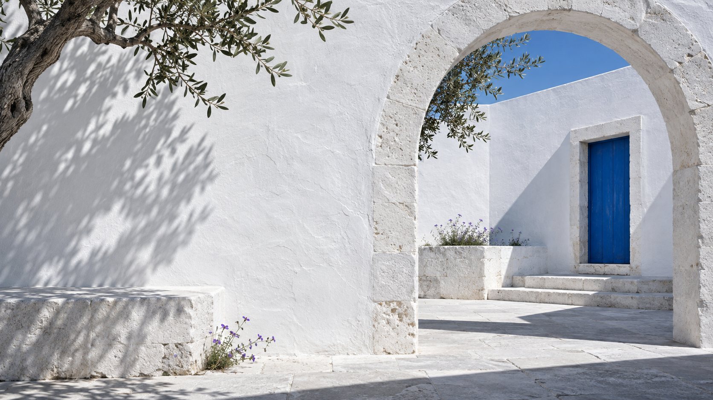</a> |
| 1 | [Paper and thought](../themes/modus-operandi/wallpapers/02-paper-relief.png) | <a href="../themes/modus-operandi/wallpapers/02-paper-relief.png">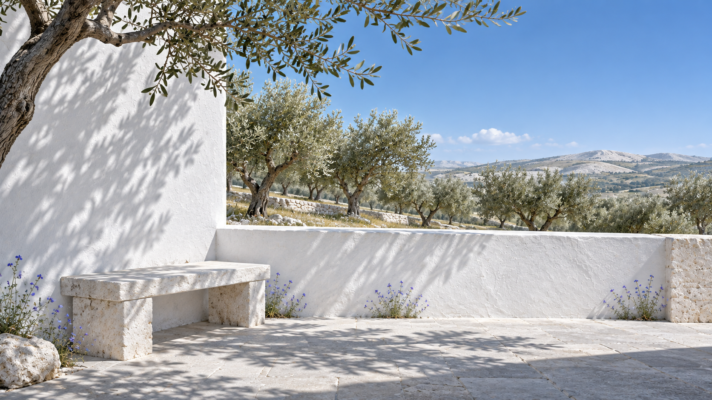</a> |
| 2 | [Olive paths](../themes/modus-operandi/wallpapers/03-olive-paths.png) | <a href="../themes/modus-operandi/wallpapers/03-olive-paths.png">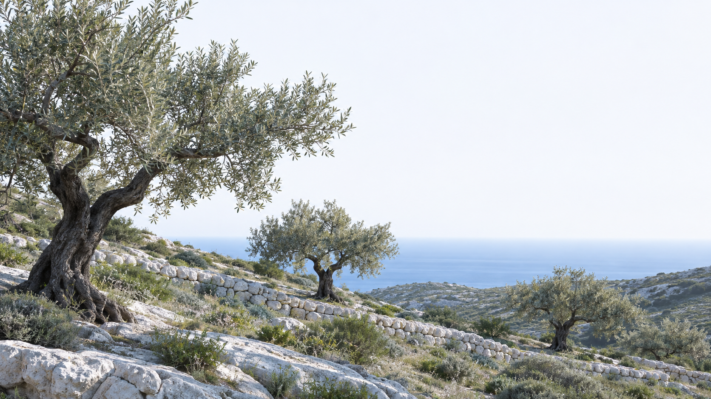</a> |
| 3 | [A place to think](../themes/modus-operandi/wallpapers/04-study.png) | <a href="../themes/modus-operandi/wallpapers/04-study.png">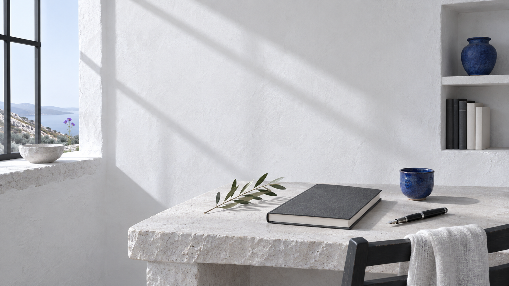</a> |

## Modus Vivendi Tinted

[Theme bundle](../themes/modus-vivendi-tinted/README.md) · [Complete prompts and sources](../themes/modus-vivendi-tinted/SOURCES.md)

| Index | Wallpaper | Preview |
| --- | --- | --- |
| 0 | [Violet herbarium](../themes/modus-vivendi-tinted/wallpapers/01-violet-herbarium.png) |  |
| 1 | [Dusk amphitheatre](../themes/modus-vivendi-tinted/wallpapers/02-dusk-amphitheatre.png) | <a href="../themes/modus-vivendi-tinted/wallpapers/02-dusk-amphitheatre.png">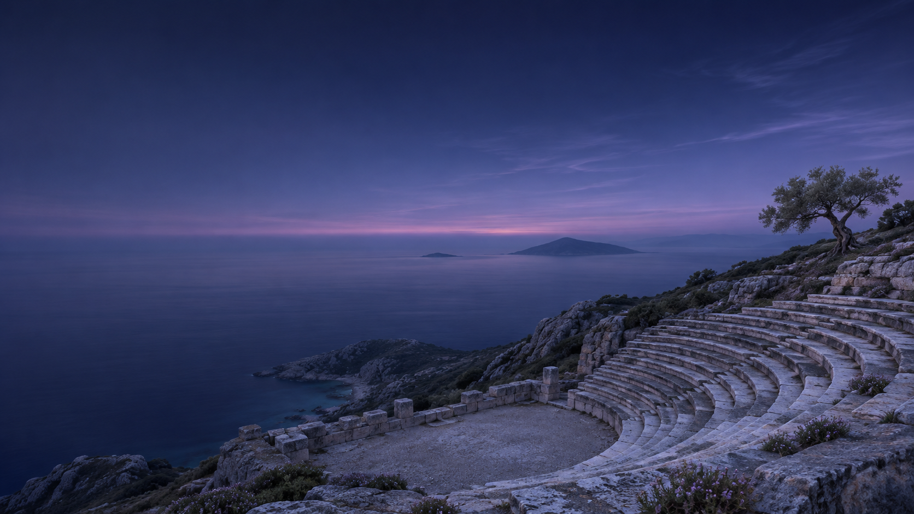</a> |
| 2 | [Stellar dialogue](../themes/modus-vivendi-tinted/wallpapers/03-stellar-dialogue.png) | <a href="../themes/modus-vivendi-tinted/wallpapers/03-stellar-dialogue.png">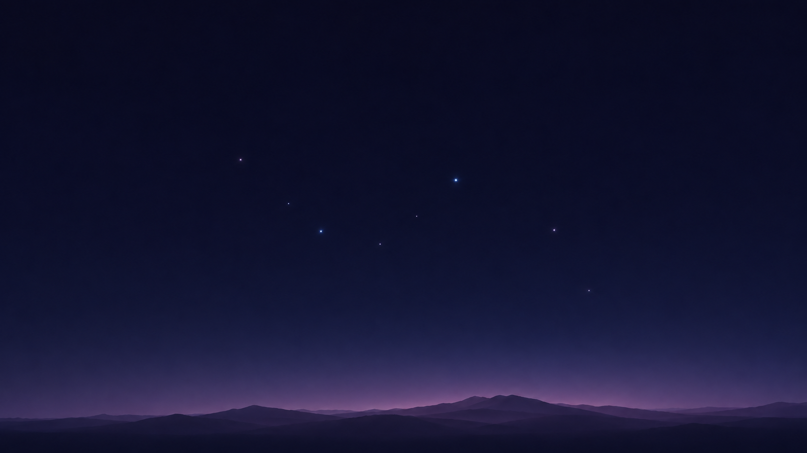</a> |
| 3 | [Plum scriptorium](../themes/modus-vivendi-tinted/wallpapers/04-plum-scriptorium.png) | <a href="../themes/modus-vivendi-tinted/wallpapers/04-plum-scriptorium.png">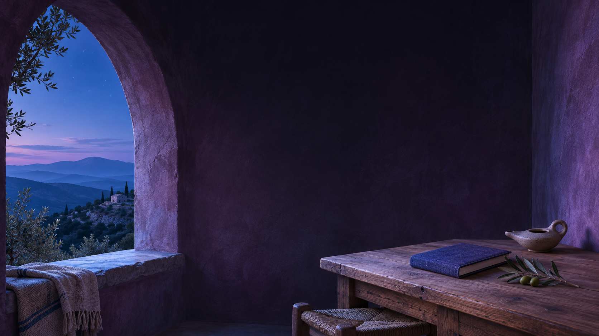</a> |

## Modus Operandi Tinted

[Theme bundle](../themes/modus-operandi-tinted/README.md) · [Complete prompts and sources](../themes/modus-operandi-tinted/SOURCES.md)

| Index | Wallpaper | Preview |
| --- | --- | --- |
| 0 | [Paper terrain](../themes/modus-operandi-tinted/wallpapers/01-paper-terrain.png) | <a href="../themes/modus-operandi-tinted/wallpapers/01-paper-terrain.png">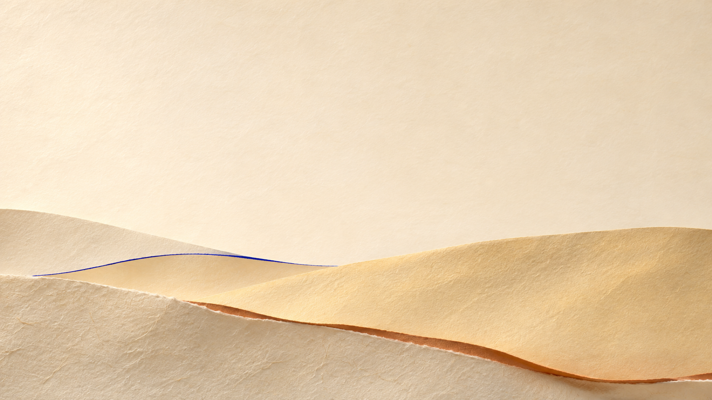</a> |
| 1 | [Portico of afternoon](../themes/modus-operandi-tinted/wallpapers/02-portico.png) | <a href="../themes/modus-operandi-tinted/wallpapers/02-portico.png">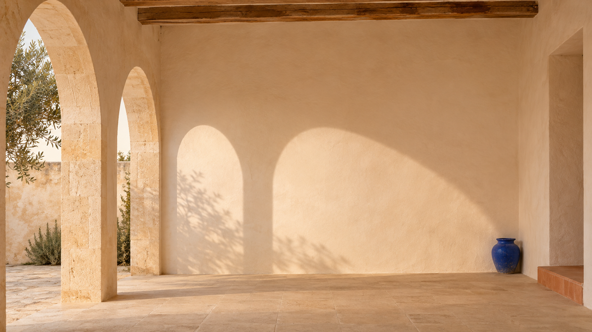</a> |
| 2 | [The long olive path](../themes/modus-operandi-tinted/wallpapers/03-olive-afternoon.png) | <a href="../themes/modus-operandi-tinted/wallpapers/03-olive-afternoon.png">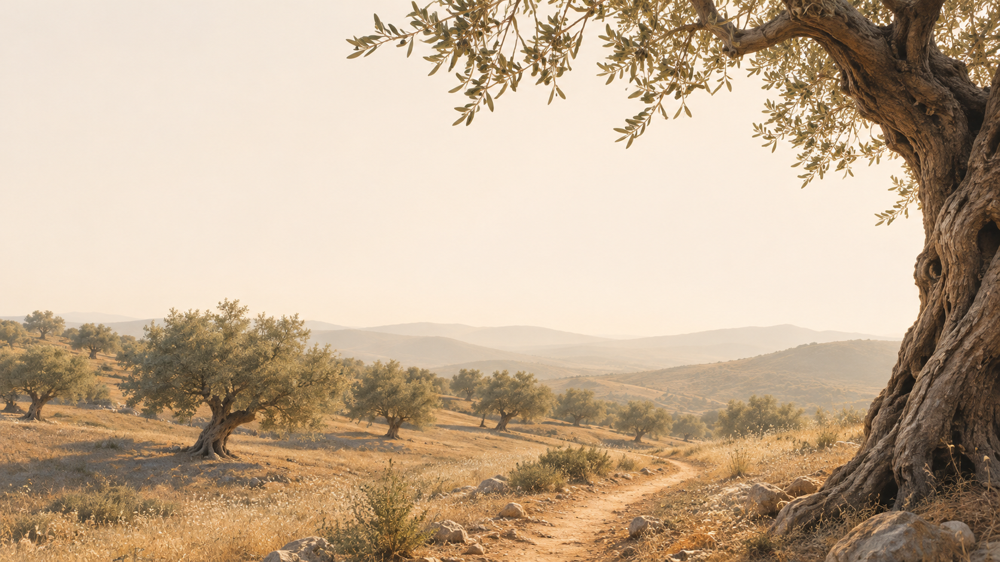</a> |
| 3 | [Sculpture and thought](../themes/modus-operandi-tinted/wallpapers/04-sculptors-table.png) | <a href="../themes/modus-operandi-tinted/wallpapers/04-sculptors-table.png">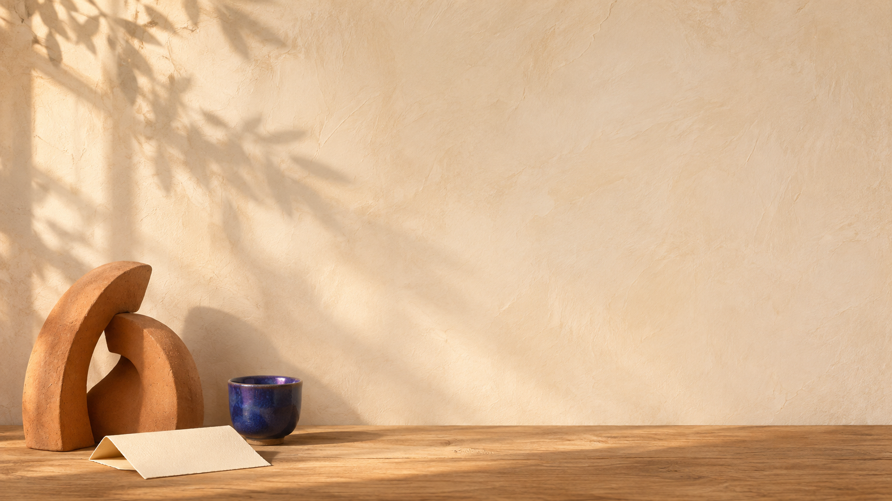</a> |

The themes’ quiet landscapes, materials, botanical studies, astronomical forms, and writing spaces offer an imaginative tribute to Protesilaos Stavrou. They do not depict his actual home or imply endorsement. The exact UI palettes follow pinned upstream Modus values; the wallpapers interpret those palettes artistically.

Wallpaper indices are zero-based. Use `--wallpaper`, `--lock-wallpaper`, and `--login-wallpaper` independently. The theme’s own four images appear before any shared or other-theme images discovered by Grove.
